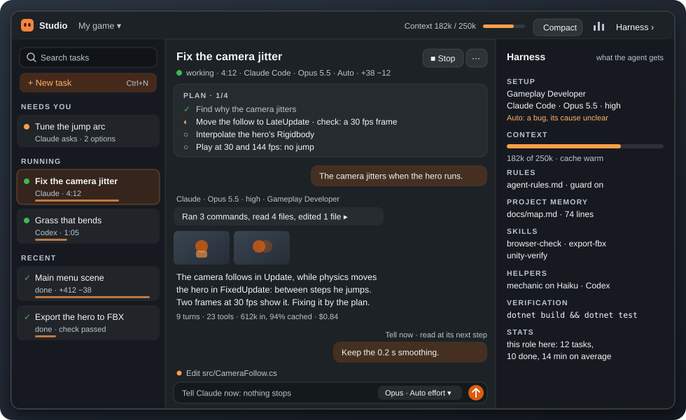

<p align="center">
  
</p>

<h1 align="center">Link</h1>

<p align="center">
  <b>Ask about what is on your screen. Hand the work to an agent. Stay in your app.</b>
</p>

<p align="center">
  
  
  
  <a href="LICENSE"></a>
</p>

Link is a small always-on-top overlay for Windows. You work in Unreal, Unity, Blender, an IDE or a browser; Link sends
your question to your ChatGPT conversation together with what you choose (a frame of the window you work in, the
clipboard, the project note, your voice) and shows the answer on top of your work. When the answer is work in your
folder, **Claude Code** or **Codex** does it in **Link Studio**, under a harness that keeps them on track.

- **Ask in place.** Type or hold a key and talk; the card shows what the model sees and streams the answer.
- **Talk hands-free.** Local speech recognition, a Conversation mode, answers read aloud.
- **Agents as conversations.** A task is one thread from the brief to the result: its plan, steps, pictures, changes
  and cost. Several tasks run side by side.
- **A harness that holds.** Rules, the project's map and skills, a guard that refuses waste, a check after every run
  and a review of the whole plan: the same for Claude and Codex.
- **Away from the desk.** A Telegram bot tells you when a task needs you and takes your answer.

## Quick start

1. You need Windows 11 x64 and a ChatGPT account (.NET comes inside the build). For agents:
   [Claude Code](https://docs.claude.com/en/docs/claude-code) and/or [Codex CLI](https://github.com/openai/codex) on
   your subscription. For voice: [Visual C++ Redistributable 2022 x64](https://aka.ms/vs/17/release/vc_redist.x64.exe).
2. Download `Link-<version>-win-x64.zip` (~100 MB) from [Releases](../../releases), unzip it to a folder of your own
   (not Program Files) and run `Link.exe`. The build is not signed: SmartScreen may warn, More info → Run anyway.
3. **Welcome to LINK** checks your agents. Then open the panel, **ChatGPT page**, sign in once, and pick a folder for
   the project. Claude Code signs in from Settings → Agents → **Sign in**, Codex with `codex login`.

Optional: paste [docs/harness/chat-instructions.md](docs/harness/chat-instructions.md) into the instructions of the
ChatGPT project Link talks to.

## Ask

- **The card.** Write, or hold `Ctrl+Alt+V` and talk; `Enter` sends. **ChatGPT · ‹chat› ▾** says where it goes (a
  chat, or the project's agent), **Fast · Normal · Deep** how hard to think.
- **What goes along is in sight.** **Sees** shows the frame (a window, a monitor or a region; or a fresh frame of the
  window you work in on every send), and chips show the project note and the clipboard; `×` leaves one out. Above the
  answer, **Saw** lists what really went.
- **The answer** streams in as Markdown; **Listen** reads it aloud. Under it, **Ask again ▾** (deeper, with a fresh
  screen, only your text, or corrected) and **→ Agent task**.
- **Hands-free.** **Conversation** (`Ctrl+Alt+Shift+Space`) listens while Link is free and answers aloud; hold
  `Ctrl+Alt+Shift+V` to ask about the screen in one go.
- **The panel** beside the card: the project's chats, its note, its folder, the map, skills and the check command.
- ChatGPT runs in Link's own page (WebView2) off screen, so it types at full speed with no browser open.

## Agents in Studio

<p align="center">
  
</p>

- **Start a task** with `Ctrl+Enter` in the card, **New task** in Studio (`Ctrl+N`) or **→ Agent task** under an
  answer. A card shows the brief, the agent, model, effort and access; nothing runs before **Run**. **Plan first**
  has the agent only read and propose.
- **One task, one thread.** Each run shows its steps folded ("Ran 3 commands, read 4 files…"), the pictures it looked
  at, its answer, the files it changed and what it cost. The agent's own task list is the **Plan** at the top.
- **Talk while it works.** `Enter` is **Tell now**: Claude reads your words at its next step, nothing stops. Codex
  gets **Steer now**. `Tab` keeps your words for after the run.
- **Checked work.** Your check command (a build, tests) runs after every run with edits; a failure goes back to the
  agent, twice at most. When a plan of three steps or more is done, **Check the work** has a fresh session review the
  whole diff step by step, and **Fix them** sends its findings back.
- **Steer the task.** **Hand off ▾** to the other agent, **Compact** (a new session from the task's state),
  **Start over with a note**, **Escalate**; at a usage limit, **Continue at 15:45**.
- **Review and undo.** **Review** opens the diff: comment on lines, **Send review**. **Undo agent changes** in Git
  and Perforce (each task gets its own pending changelist).
- **Access.** **Edit** asks before commands, **Auto** asks nothing. **No-stop** takes the agent's recommended choice
  after 10 s; `git push`, `p4 submit`, `gh pr merge` and `gh release` stay refused.
- **Spend** (`Ctrl+Shift+U`): where a task's tokens went, tips to save with a **Fix**, the context curve, usage windows
  and history; today's and this month's cost by [ccusage](https://ccusage.com).

## The harness

What every agent session gets, shown in the **Harness** column (`Ctrl+Shift+H`):

| Part | What it does |
|---|---|
| **Rules** | `harness/agent-rules.md` beside `Link.exe`, at the start of every session, in any folder; editable without a rebuild. |
| **Project memory** | `docs/map.md` (what is where, how to build and check) and skills in `.agents/skills/<name>/SKILL.md`, one source for both agents. Agents keep them current; a long session that kept nothing is asked once, before it ends. |
| **Guard** | `Link.Guard`, Claude Code's hook, refuses waste with what to do instead: a big file read whole, a check's leftovers in the project, long waits, long inline scripts, the same picture twice, 15 searches without a change, edits to Link's data or the agents' settings. Codex gets the same rules as text. |
| **Roles and packs** | Specialists (Gameplay Developer, 3D Artist, QA…) and tool packs (Unreal, Unity, Godot, Blender, Cascadeur, Perforce) in `%USERPROFILE%\LinkPacks`, shared by all your games. **Share with all games** passes a lesson on; a **Team pack** gives a teammate your roles and skills. |
| **Helpers** | `mechanic` on Haiku for mechanical edits; Codex as Claude's tool on the ChatGPT subscription. |
| **Effort and context** | **Effort Auto** picks each run's effort and says why; one context budget for both agents; MCP servers only from the project's `.mcp.json`. |

More: [docs/LOOP_PLAN.md](docs/LOOP_PLAN.md) (how a task runs), [docs/PORTABLE_HARNESS_PLAN.md](docs/PORTABLE_HARNESS_PLAN.md)
(the same harness for other models), [bench/](bench/README.md) (Link Bench: harnesses and models on one small game).

## Away from the desk

A Telegram bot of your own: `@BotFather` → `/newbot` gives a token; Settings → Remote control → paste it, **Pair
Telegram**. Each task gets one card that updates quietly; when it needs you, a new card notifies with buttons (the
agent's options, Allow, Deny, Stop, No-stop, Changes as a `.patch`). Words or a photo answer the task, also while it
works. `/new`, `/plan`, `/auto`, `/tasks`, `/spent`. A model's review window opens in any browser through a Cloudflare
quick tunnel while Link runs.

## Hotkeys

| Action | Default |
|---|---|
| Show or hide Link | `Ctrl+Alt+Space` |
| Push-to-talk | `Ctrl+Alt+V` |
| Send | `Ctrl+Alt+Enter` |
| Whole desktop · active window · region | `Ctrl+Alt+D` · `Ctrl+Alt+W` · `Ctrl+Alt+Shift+R` |
| Conversation on or off | `Ctrl+Alt+Shift+Space` |
| Ask about the screen (hold) | `Ctrl+Alt+Shift+V` |
| New agent task (in the card) | `Ctrl+Enter` |

All change in Settings. `F13`–`F24` work without modifiers: handy on a macro pad or a pedal.

## Build and test

```powershell
dotnet build Link.sln -c Release
dotnet run --project tests/Link.Desktop.Tests -c Release
src\Link.Desktop\bin\Release\net10.0-windows\Link.exe
```

The tests need no microphone and no real ChatGPT; the companion script runs on mock ChatGPT pages in headless Edge.
A running Link locks its exe: Exit it from the tray before you rebuild.

## Your data

Everything stays in `%LocalAppData%\Link`: `settings.json`, `projects.json` and `Projects\<id>\` (history, agent
tasks), `Screenshots\`, `Recordings\`, `Models\` (speech), `WebView2\` (the ChatGPT sign-in), `usage-history.json`,
`link.log` (timings and errors). A Gemini key for voice is encrypted for your Windows account.
Nothing is captured without your action or a mode you turned on.

## How it is built

```text
src/Link.Desktop/   the app: Models, Services (requests, voice, agents, harness), Windows (Win32), the windows
src/Link.Guard/     the guard: Claude Code's PreToolUse and Stop hook
companion/          the script that drives ChatGPT in Link's own page
docs/harness/       the agents' rules, roles and tasks, copied beside Link.exe
tests/              logic checks without a test framework; companion checks on mock pages
bench/              Link Bench
```

`IChatIntegration` keeps ChatGPT behind one interface ([companion/README.md](companion/README.md));
`AgentCoordinator` runs a task over `ClaudeCodeProvider` or `CodexProvider`.

## Limits

- **ChatGPT.** A very long chat answers slowly in Link and in ChatGPT alike: start a new one (**New chat ▾**, with a
  summary if needed). Its page takes 650–750 MB right after an answer and about 450 MB at rest.
- **The ChatGPT page can change.** Link logs what it saw when it cannot read an answer.
- **Voice.** Models download on first use (Whisper Base 148 MB; turbo 574 MB with a Vulkan GPU). No echo
  cancellation: interrupt an answer with push-to-talk, not with your voice.
- **Agents.** Claude Code and Codex work in your folder; chat is ChatGPT only. Edits to one folder go one run at a
  time (no worktrees).
- **Screen.** Exclusive fullscreen and protected video capture black; Link does not attach such a frame.

> **Disclaimer.** An unofficial project, not affiliated with OpenAI or Anthropic. Link drives the ChatGPT web page in
> its own window on your behalf: this may conflict with OpenAI's terms and may break when ChatGPT changes. Agents work
> in your folder with the access you give them and spend your subscription. Use at your own risk, without warranty.

License: [MIT](LICENSE).
