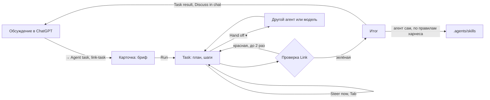

# Link

<p align="center">
  
</p>

Компактный Windows desktop companion на C#/.NET 10 и WPF. Вы работаете в Unreal, Blender, IDE или браузере, а Link
висит маленьким overlay поверх: собирает нужный контекст — текст, голос, скриншоты, clipboard, текущее приложение —
отправляет его в связанную беседу ChatGPT и показывает ответ, не заставляя переключаться в окно чата. Работу в вашей
папке — правки, проверки, карту проекта — делает агент на выбор: **Claude Code**, **Codex** или своя модель (GLM,
DeepSeek, OpenRouter, локальная Ollama) через тот же Claude Code. Задачи агентов живут в отдельном окне **Studio**.

**UI для пользователя — Link. Встроенная страница ChatGPT, CLI агентов — внутренняя реализация.**

## Как работать с Link

### 1. Спросить

<p align="center"></p>

1. **Проект и точка ChatGPT** — зелёная: на связи, красная: войдите в ChatGPT. Клик — выбрать или создать проект,
   связать его с беседой. Пока есть задача агента, рядом — **пилюля агента** (`Claude · 4:12`, `Claude needs you`,
   `Claude done`; `+1` — ещё прогоны в работе); клик открывает задачу.
2. **Панель** (Expand) и **Hide**. Спрятать и показать Link — `Ctrl+Alt+Space`.
3. **Заметка проекта** — чип с её первой строкой (над чем вы работаете); уходит с вопросом, `×` — без неё на один
   вопрос, клик — править.
4. **Вопрос.** Пишите или держите `Ctrl+Alt+V` и говорите — слова появляются в поле; `Enter` отправляет — подсказка
   внизу говорит куда, а пустое поле подсказывает беседу: «Ask in «Nori jump tuning»…».
5. **Куда и как.** **ChatGPT · <беседа> ▾** — куда уйдёт сообщение: беседа ChatGPT или агент проекта (раздел 3);
   другие беседы — во вкладке Chats панели (`Ctrl+K`). Ответ подписан своей беседой. **Fast · Normal · Deep** —
   насколько глубоко думать. **Conversation** — разговор без рук. **Only my text** — следующий вопрос уходит только
   с вашим текстом и вложениями, без чипов Link.
6. **Что видит модель** — строка **Sees** под полем: приложенный снимок (окно, монитор, область) или «свежий кадр
   окна при отправке», с миниатюрой; клик — меню снимков. Voice — голос, Clipboard — буфер обмена.
7. **Что уходит с вопросом** — чипы: приложение и заголовок его окна, состояние проекта, буфер; `×` убирает на этот
   запрос. Над ответом — **Saw: …**: что ушло на самом деле, с миниатюрой отправленного кадра.
8. **Ответ** приходит по мере печати, Markdown с кодом и таблицами; **Listen** читает вслух, **Copy** копирует.
9. **Под ответом два действия.** **Ask again ▾** — тот же вопрос из того же снимка: глубже, со свежим экраном, только
   ваш текст или с поправкой (Edit the question — поправить ослышку). **→ Agent task** — карточка задачи, где бриф —
   выделенная часть ответа, его блок `link-task` или весь ответ, плюс вопрос; ничего не запускается до Run.

### 2. Проект и панель

<p align="center"></p>

Две вкладки, как в приложениях ChatGPT и агентов: **Chats** (беседы ChatGPT) и проект; кнопка **Tasks** между ними
(с точкой: агент работает, ждёт вас, закончил) открывает **Studio** — окно задач агентов (раздел 3).

1. **Chats** — беседы ChatGPT этого проекта, последняя сверху; та, куда уйдёт следующее сообщение, помечена **here**.
   Клик открывает беседу: вопросы справа, ответы слева, **Show in Link** показывает ответ целиком в карточке; Link
   с этого момента пишет в неё. **New chat ▾** начинает новую (в меню — с выжимкой старой: длинные беседы ChatGPT
   отвечает медленно), строка состояния открывает страницу ChatGPT, меню проекта — **Link ChatGPT conversation…**
   (беседа из тех, что знает страница). В беседе видно то, что шло через Link (150 последних вопросов проекта).
2. **Tasks** → **Studio**: задачи агентов (раздел 3) и окна их лимитов полосками; клик по полоске спрашивает агента о его
   usage заново (без токенов; пока Link ничего не знает — строка «click to ask»). Карта проекта (Update map) идёт там же
   отдельной строкой со своим Stop и не трогает открытую задачу.
3. **Проект** (вкладка с его именем). **Заметка** — первая строка: над чем вы работаете; дальше цель, решения,
   факты. Уходит с вопросами и задачами чипом, который можно убрать на один вопрос.
4. **Рабочая папка** — где работает агент; выбирается только явно. Под ней — как откатываются правки агента: Git,
   Perforce (каждая задача — свой pending changelist в P4V) или копия папки.
5. **Карта проекта** — Write map / Update map: агент осматривает папку и пишет `docs/map.md` (что где лежит, как
   собрать и проверить); агенты читают её первой, а не ищут по папкам.
6. **Skills папки** — повторяемая работа, записанная один раз: агенты ведут их сами по правилам харнеса (раздел 3), а
   колонка Harness в Studio их показывает. Клик показывает `SKILL.md`.
7. **Проверка после правок** — ваша команда: сборка, линтер, тесты. Link сам запускает её после задачи с правками.

### 3. Агент: задача как беседа

<p align="center"></p>

**Studio** — обычное окно Link (кнопка Tasks панели, пилюля агента, пункт **Studio** в tray; место и размер
запоминаются): посередине задачи проекта, справа складная колонка **Harness** — что агент получил на самом деле и
почему ведёт себя так. В заголовке — контекст открытой задачи (`Context 182k / 450k (40%)`) и **Compact**.

Studio коротко:

- **Задача — беседа**, как в приложениях агентов: бриф, прогоны со свёрнутыми шагами, ответ в Markdown, файлы,
  токены и доля подписки; поправка на ходу (`Enter`), слова после шага (`Tab`), Stop, Hand off, Finish.
- **Задачи рядом:** несколько задач работают одновременно, каждая со своим агентом; Studio показывает открытую, список
  — как стоят остальные. Правки в одной папке идут по очереди, чтение и план — сразу.
- **Агенты на выбор и вместе:** Claude Code, Codex или своя модель (GLM, DeepSeek, OpenRouter, Ollama) через Claude
  Code; **Team** — ведущий (Opus) раскладывает большую задачу на шаги, Link раздаёт их Opus / Codex / Haiku по виду
  работы, показывает кто и почему, а ведущий проверяет шаги исполнителей подешевле.
- **Обучение специалиста (Train):** специалист изучает ваши ссылки и PDF, пишет уроки-кандидаты, сдаёт экзамен —
  настоящую задачу по вашим референсам — и только уроки сданного экзамена попадают в skill.
- **Специалисты** (3D Artist, Gameplay Developer, QA…) и **пакеты инструментов** (Unreal, Unity, Godot, Blender,
  Cascadeur, Perforce): общие умения для всех игр, проект добавляет к ним своё.
- **Харнесс:** правила, карта проекта, skills, проверка после правок, Effort Auto, Compact из состояния задачи — и
  колонка Harness, где всё это видно для открытой задачи, вплоть до текста, который получил агент.

Новую задачу открывает `Ctrl+Enter` в поле, **New task** в Studio, **→ Agent task** под ответом ChatGPT или
**Give to agent** на его блоке `link-task`. Сначала — карточка, потом задача в **Studio** — одна беседа от
брифа до Finish, сколько бы прогонов, поправок и передач в ней ни было. Пока задача открыта, `Enter` на маршруте
**To Claude · …** отдаёт ей ваши слова и чипы (снимок экрана — картинкой): поправка, пока агент работает, ответ после.

1. **Бриф** — то, что агент получит слово в слово (первая строка — название задачи); правится перед запуском.
   Ниже — картинки, которые уйдут агенту, и что ещё идёт вместе с ним (заметка, буфер).
2. **Агент, модель, effort, доступ.** Модели и effort — собственные у каждого агента (у Codex — его список моделей
   и уровни каждой); по умолчанию — **Default** из Settings → Agents или то, что задано в самом CLI. Агент у новой
   карточки — всегда агент по умолчанию из Settings (проект его не запоминает); только пока его лимит кончился, карточка
   стартует на другом и говорит об этом («Claude's limit is reached until 21:00: Codex takes it; change the agent if
   you want»). Сохранили Settings при открытой карточке — её агенты, модели и effort обновляются, бриф и ваш выбор
   остаются. Под агентом — его окна лимитов полосками. **Effort Auto** (по умолчанию) — Link выбирает уровень каждого прогона сам, модель
   и агента — никогда: после провала — на ступень выше; иначе — что агент сам назвал для следующего шага (блок
   `link-next`); план — medium; ответ после прогона — как прошлый; новая задача — по брифу (архитектура и непонятный
   сбой — high, переименование и формат — low, только для короткого брифа), потом по роли, иначе medium; шаг команды —
   по виду из плана (модель, редактор, дизайн, непонятный сбой — high, код и тесты — medium, механика и тексты — low);
   выше Extra high — только вручную.
   Причина видна в беседе и в Harness. Доступ: **Edit** — правит файлы, команды — с вашего разрешения; **Auto** — правит и
   запускает команды без вопросов, рискованное останавливает проверка самого агента.
   **Ctrl+V** (скрин или файлы) и **перетаскивание файлов** в карточку или в поле ответа прикладывают их: картинки
   агент видит как изображения, остальные файлы — по пути, их папка открыта ему на чтение; клик по вложению убирает
   его. Пока агент работает, новую задачу можно завести: **Run** запускает её сразу, рядом — открытая задача работает
   дальше и ждёт вас в списке. Правки в одной папке (или во вложенной) идут по очереди: прогон, который правил бы папку,
   где сейчас правит другая задача или Link пишет карту, ждёт и стартует сам (**Stop** снимает ожидание); чтение и
   план идут сразу.
3. **Сначала план** — агент только читает и предлагает (на **Strong** из Settings), запускаете вы: план выполняется
   в той же сессии на модели карточки. Пока сессия в режиме планирования, рядом с Hand off и Finish стоит
   **Plan mode ✕**: ответы до него только обсуждают план, после — идут с правками.
4. **Специалист и skills.** Link предлагает роль по брифу — Technical Designer, UI/UX Designer, 3D Artist,
   Rigger / Animator, Gameplay Developer, Level Artist, QA / Playtest, Build / Performance — и до четырёх skills папки
   чипами (сначала skills роли); всё меняется на карточке, **General** — без роли. Свои роли папки —
   `.agents/roles/<id>.md` (заменяют встроенные с тем же id). Роли не знают движка: что делать в Unreal, Unity,
   Godot, Blender, Cascadeur, им добавляют **пакеты инструментов** в `%USERPROFILE%\LinkPacks\<pack>` (`pack.md`,
   `rules.md` — правила для любой задачи в таком проекте, `roles/`, `skills/`; у Unity — `unity-verify`, сборка без
   редактора, и `unity-editor`, мост к живому редактору через Unity CLI; у Blender — `blender-live`, `blender-model`,
   `blender-anim`), общие для всех игр; Link берёт пакеты, чьи файлы есть в папке (`*.uproject`, `*.blend`…;
   Unity-проект — и в её подпапке, рядом с Art),
   Blender и Cascadeur — в любой папке Unreal, Unity или Godot (`with:` в `pack.md`). Как skills учатся и
   передаются — раздел 4, «Skills: общие и проектные».
   **Team** (галка сама, когда бриф называет двух специалистов и больше или перечисляет три дела списком): ведущий
   (Strong) планирует шаги, Link раздаёт их по уровням — Haiku, Codex, Opus — с причиной. План сверху задачи — шаг
   строкой (первая фраза, исполнитель, специалист), клик раскрывает весь шаг и почему этот исполнитель; в ленте —
   кому ушёл шаг и что он передал дальше. Исполнитель получает свой шаг целиком, остальные — заголовками, и что
   передали шаги до него (Harness → Injected context показывает этот текст). Шаг Haiku или Codex с
   правками ведущий проверяет в своей сессии, только чтением (diff, ответ, проверка): принять, вернуть с замечаниями
   (в сессию того же исполнителя, не больше двух раз) или отдать сильнее; «stop» и проверка без вердикта ждут
   **Accept and go on** или ваших слов ведущему. Выключается в Settings → Agents. После провала шаг повторяется и
   поднимается уровень, шаг «на вкус» ждёт **OK, next step**. Шаг модели или редактора, «сделанный» без единого
   изменённого файла, — **unverified**: исполнителю не засчитывается и ждёт вашего OK. Шаг арта (`asset` — уникальная
   модель, `instance` — экземпляры генератора проекта) у специалиста со стилем проекта (skill `art-style`) вместо
   ведущего судит **арт-критик**: новая сессия другого агента, чем у художника (нет такого — того же), только чтением
   и вслепую — задача, кадры, которые назвал художник, сохранённые файлы и ваши референсы, без рассказа художника.
   Вердикт с оценкой 1–5: принять, вернуть художнику с дефектами (не больше двух раз) или оставить вам с замечаниями;
   ваши слова после вердикта идут художнику вместе с ними. Галка **Art critic** в Settings → Agents. Под настройками —
   строка `Context budget 450k · 5 skills · MCP: unreal` и **Harness**.
   **Train the specialist** (вместо Team, нужен специалист): цель — тема и источники (ссылки в тексте, PDF и
   картинки вложениями). Специалист изучает их только чтением (веб — без вопросов) и пишет до 8 **уроков-кандидатов**:
   правило, причина, в какой skill и для всех ли игр. Они в карточке **Lessons** вместо плана; рабочие агенты их не
   получают. Слова до **Ready for exam** — обсуждение с учеником. После — ваши следующие слова и есть **экзамен**:
   настоящая задача проекта с референсами; её делает новая сессия специалиста с уроками и rubric роли, без лекции,
   сдаёт сохранённый файл, review sheet и самооценку (Harness → Injected context показывает её бриф). Слова до оценки —
   правка в той же сессии; оценка **1–5**: 4–5 — урок, применённый на экзамене, становится доказанным (✓), сессия
   экзамена вписывает его в skill (общий — в копию skill пакета, проектный — в `<пакет>-project`), дальше обычный
   **Share with all games**; 1–3 — уроки остаются кандидатами для следующего экзамена. Экзамен без изменённых файлов —
   unverified при любой оценке. Экзамен по арту до вашей оценки судит арт-критик: его оценка и дефекты — рядом с
   оценкой, а ваша оценка засчитывается ему — критик, который в проекте чаще не согласен с вами, больше не судит,
   доказанный идёт первым. Сданный ассет сессия экзамена кладёт в линейку одобренных `Art/Approved/`.
5. **Проверка после правок** (если задана у папки). **Run** — без него ничего не запускается.
6. **Задача:** ‹ к списку, название, состояние (working · 3:12, done, needs you), агент · модель · доступ, `+N −M`
   строк; **PLAN · 2/5** — план агента со статусами ✓ ◐ ○, как в его приложении (TaskCreate/TaskUpdate и TodoWrite у
   Claude, todo list у Codex); **■ Stop**, **⋯** — Discuss in chat, Compact, Undo agent changes / Restore the copy,
   Start over with a note, **Export for analysis** (вся задача Markdown-ом в буфер — вставить в ChatGPT в браузере — и
   файлом в `Projects\<id>\Exports`: цифры, бриф, план команды, каждый прогон с шагами и ответом), Console.
7. **Беседа задачи:** ваши слова справа; каждый прогон агента слева — модель, итог, шаги свёрнуты группами, как в
   приложениях агентов («Ran 3 commands, read 2 files, edited 1 file ▸»), его ответ (Markdown с заголовками, списками
   и кодом; агенты пишут по-английски — так дешевле), изменённые файлы, время и
   токены; между ними — передачи, смены модели, лимиты. Петля — карточка
   **Start over with a note** / **Escalate** (та же сессия на Strong).
8. **Вопрос агента** — варианты кнопками, как в его собственном приложении; можно ответить своими словами. Агент
   задаёт его блоком `link-ask` по правилам харнеса (у Claude свой AskUserQuestion в `-p` выключен).
9. **Поле для агента:** пока он работает, `Enter` — **Steer now** (останавливает шаг и продолжает в той же сессии
   с вашими словами, ничего не перечитывая), `Tab` — **After this step**; после — ответ в той же сессии, и после
   **Stop** тоже. Рядом с кнопкой отправки — **специалист · модель · effort ▾**, как выбор модели в приложениях
   агентов: на чём пойдут ваши следующие слова в той же сессии (Auto effort, любой effort и модель агента, другая
   роль). Выбор ничего не запускает и остаётся для следующих прогонов; Steer и Stop не поднимают Auto effort.
10. **Hand off ▾** — другой агент в новой сессии (сначала карточка с брифом из истории задачи — его можно поправить);
    **Back to …** — первый агент в своей сессии. **Finish** — задача закрыта и остаётся в списке.
    Когда своя модель настроена, задача подсказывает строкой, что ей можно отдать работу: написанный план или роль, с
    которой она здесь справлялась (3+ прогона, 2/3 сделано), — **Hand off to …** открывает обычную карточку передачи;
    сама задача не переключается никогда.
11. **Контекст и Compact.** Бюджет контекста — один на всех агентов (Settings → Agents, 450k по умолчанию): дальше
    агент сжимает сессию сам. **Compact** (⋯ или заголовок Studio) — новая сессия того же агента из состояния задачи:
    цель, ваши решения, план, файлы, проверка, проблемы, следующий шаг. Его собирает Link из записи задачи, без
    модели; перед запуском его видно на карточке и можно поправить. Пока `AutoCompact` в settings.json включён (по
    умолчанию да), Link сжимает сам там, где сессия всё равно пересобирается: после ожидания лимита и в ответе после долгой паузы (кэш
    сессии остыл, час и больше); в ленте — «Compacted: … · причина». Поправку (Steer) и план он не трогает.
12. **Лимит.** У 90 % окна Link тихо предлагает остановиться и передать задачу; кончился лимит — **Hand off to …**
    и галка **Continue at 15:45**, как в приложении Claude: включена — та же сессия продолжится сама через минуту после
    сброса, пока Link запущен (ожидание хранится в задаче и переживает перезапуск Link); снятая — задача ждёт ваших
    слов, и галка остаётся снятой для следующих лимитов. Строка прогона и задачи говорит, сколько он взял от
    подписки («used 4% of Codex 5 h, 1% of week»): разница окон до и после прогона, ориентир при чужих прогонах на
    том же аккаунте.
13. **Голос** не мешает чату: агент говорит только «начал работу», «закончил работу», «ждёт решения» или «спрашивает»,
    когда голос свободен, и замолкает от любой отправки или push-to-talk.

После каждого прогона итог задачи сам ложится чипом **Task result** в следующий вопрос ChatGPT — `×` убирает.



### 4. Что Link даёт агенту

- **Правила** (`harness\agent-rules.md` рядом с `Link.exe`) — в начале каждой новой сессии, в любой папке:
  запуск без диалога, режим чтения, карта, skills, особенности Windows. `AGENTS.md` в папку класть не нужно.
- **Карта** `docs/map.md` и **skills** `.agents/skills/<имя>/SKILL.md` — один источник для обоих агентов: Codex
  находит skills сам, Claude Code получает их список с правилами.
- **Проверка — дело Link:** агенту сказано, что её запустит Link; красная возвращается агенту с концом вывода.
- **MCP-серверы проекта** (редактор Unreal, Blender) — только из `.mcp.json` в рабочей папке, у обоих агентов:
  Claude Code получает его с `--strict-mcp-config` (коннекторы claude.ai не едут), Codex — от Link, а серверы из его
  собственного конфига в прогонах Link выключены (сам конфиг не меняется). В Activity вызов MCP показывает сервер,
  инструмент и действие: `ue-mcp: tools call level place_actor`.
- **Лишнее не едет в каждый запрос:** Codex из Link работает без плагинов, приложений и управления компьютером своего
  десктопного приложения; git в песочнице Codex видит репозиторий рабочей папки своим.
- **Агент учится и убирает за собой:** выученное он пишет сразу, как доказал (прогон могут оборвать), — факты в
  карту, приёмы в skills, повторные скрипты в tools проекта; изменившееся переписывает на месте, без противоречащих
  приписок; удаляет только доказанно неверное или заменённое; в ответе называет, что сохранил, переписал и удалил.
  Сделанное вами вручную (анимацию, модель, уровень) не перезаписывает — делает рядом.
- **Специалист** — роль (`harness\roles\*.md` рядом с `Link.exe` или `.agents/roles` папки) идёт в начале сессии
  с её skills: что он делает, на что смотрит, чего не трогает.
- **Следующий шаг** — агент заканчивает ответ блоком `link-next` (шаг, effort, почему): Effort Auto берёт его для
  следующего прогона, Compact — для состояния задачи.
- **Harness** в Studio показывает всё это для открытой задачи: роль · агент · модель · effort и почему, контекст,
  правила, роль, карту, состояние задачи, skills, бриф — у команды бриф текущего шага (и Console), MCP и разрешённые
  инструменты, проверку, куда уходит код, и как здесь справлялись роли и модели (задачи, сделано, среднее время и
  токены).
- **Skills: общие и проектные.** Skill пакета (`blender-model`, `unity-verify`…) — умение инструмента для любой игры;
  проект его не переписывает, а дополняет своим skill `<пакет>-project` (`blender-project`: скрипты, ассеты, цифры
  этого проекта; «сначала прочти пакетный»). Общий урок (подводный камень Blender, способ лучше) агент пишет в копию
  пакетного skill в проекте — без путей и имён проекта; после задачи **Share with all games** отдаёт её пакету в
  `%USERPROFILE%\LinkPacks`, и его получают все ваши игры. Коллегам — через git: skill `share-packs` этого репозитория
  переносит выученное из `LinkPacks` в `docs/harness/packs`, а Link при запуске обновляет файлы пакетов, которые вы
  не меняли (`LinkPacks\.link-seeded.json` помнит, что он положил), и не трогает изменённые. Навык, которого агенту
  не хватает, можно не объяснять по сто раз, а натренировать: **Train** — урок попадёт в skill, только когда экзамен
  на вашей задаче покажет, что он работает.
- **Blender-художник:** `blender-model` ведёт по стадиям (референсы → blockout → первичные → вторичные формы →
  детали → game-ready), каждая проверяется кадрами до следующей; review sheet (6 видов × lit, matcap, wire, UV)
  снимает `shots.py` одной командой, критика — по форме, а не по наличию деталей; rubric у роли 3D Artist.
- **Стиль игры — в проекте, ремесло — в пакете.** Профиль `docs/art/STYLE.md` (палитра, игровая камера, бюджеты
  треугольников, finish, rubric стиля) и `docs/art/REFERENCES.md` (для чего каждый референс), одобренные ассеты в
  `Art/Approved/` — линейка, с которой сравнивают следующий; skill `art-style` учит работать по ним и набросать
  профиль новой игры. `shots.py` снимает и как видит игрок: `game` (камера из профиля), `thumb` (мелко на экране),
  `flat` (одни цветовые зоны); `palette.py` красит грани зонами палитры в атлас. Класс ассетов, который повторяется,
  — один **генератор** (`blender-procedural`, `gen.py`): параметры, seed и бюджет, тест контракта, лист seeds с
  игровой камеры и запись `.gen.json` у каждого ассета, чтобы собрать его снова.
- **Team pack** (внизу колонки Harness) — роли и skills папки (`.agents/roles`, `.agents/skills`) одним файлом
  `.linkpack` для папки коллеги; настройки, ключи и ваши данные туда не попадают. Импорт проверяет каждый путь до
  записи и заменяет имеющееся только после «да».
- **Без субагентов** у обоих агентов: их шаги и токены не видны в Activity и в цифрах задачи.
- **Цифры** каждой задачи — в Activity и строкой `[Agent]` в `link.log`: по ним видно, что экономит.

## Установка и первый запуск

Нужны Windows 11 и .NET 10 SDK:

```powershell
dotnet build Link.sln --configuration Release
src\Link.Desktop\bin\Release\net10.0-windows\Link.exe
```

При самом первом запуске (ещё нет `settings.json`) Link показывает **Welcome to LINK**: найдены ли Claude Code и
Codex и вошли ли вы (ссылка на установку, если нет), путь к своей модели в Settings и **Add folder…** — первый
проект для рабочей папки. Ничего не спрашивает и ни во что не входит; дальше — как ниже.

1. **ChatGPT.** Откройте панель (Expand в заголовке) и нажмите **Open chat**, войдите в свой аккаунт — один раз:
   вход хранится в профиле `%LocalAppData%\Link\WebView2`. Откройте нужную беседу, закройте окно, в панели нажмите
   строку беседы и **Link**. Или сразу **New chat** — первое сообщение из Link создаст беседу и свяжет её с проектом.
2. **Агенты.** Один раз `claude auth login` или `codex login`. Settings → Agents показывает, найден ли агент, вошли
   ли вы и его версию; там же — агент по умолчанию, доступ, с которого начинается карточка, свой путь к exe, модель
   (у Claude — Opus 5.5, Fable 5.1, Sonnet 5.5, Haiku 4.5; у Codex — модели вашего аккаунта из его списка; Default —
   настройка самого агента) и effort: Low, Medium, High, Extra high, Max — самый высокий. Ultra у Codex и ultracode у
   Claude работают через субагентов, а Link запускает агентов без них, поэтому их в списке нет.
   **Своя модель** (Settings → Agents → Custom model) — третий агент через ваш Claude Code: **GLM (Z.ai)** —
   GLM-4.7-Flash бесплатно, ключ на z.ai; DeepSeek; OpenRouter (бесплатные модели `:free`); **Ollama** — локально,
   ничего не уходит с ПК; или любой сервер с Anthropic Messages API. Ключ хранится зашифрованным для вашей учётной
   записи Windows и не попадает ни в лог, ни в Console. Сама она не выбирается никогда: только на карточке, в
   Hand off или для ответов Link (карта, заметка) — галочкой в Settings. Картинки ей не уходят.
3. **Инструкции для ChatGPT** — вставьте [docs/harness/chat-instructions.md](docs/harness/chat-instructions.md) в
   инструкции проекта ChatGPT, с которым связан Link; общие советы — [docs/harness/prompting.md](docs/harness/prompting.md).

`Alt+F4` прячет Link в tray, завершить его — `Exit` в меню tray. Перед пересборкой в `bin\Release` завершите Link:
запущенный `Link.exe` блокирует файл, а второй запуск только покажет «Link is already running». Номер сборки — внизу
Settings.

### Hotkeys по умолчанию

| Действие | Hotkey |
|---|---|
| Показать/скрыть | `Ctrl+Alt+Space` |
| Push-to-talk | `Ctrl+Alt+V` |
| Отправить запрос | `Ctrl+Alt+Enter` |
| Весь desktop | `Ctrl+Alt+D` |
| Активное окно | `Ctrl+Alt+W` |
| Выбор области | `Ctrl+Alt+Shift+R` |
| Conversation вкл./выкл. | `Ctrl+Alt+Shift+Space` |
| Спросить про экран (держать) | `Ctrl+Alt+Shift+V` |
| Новая задача агенту (в поле вопроса) | `Ctrl+Enter` |

Совет: клавиши `F13`–`F24` работают как hotkey без модификаторов — удобно повесить push-to-talk на кнопку макропада
или педаль (назначьте им F13–F24 в их программе, затем запишите клавишу в Settings).

## Возможности подробно

**Overlay**
- frosted-glass always-on-top: перетаскивание, ширина 320–1200 px, высота по содержимому; нижним краем задаётся
  предел роста (двойной клик по нему возвращает компактный режим); click-through, прозрачность;
- **Hide** — кнопка `—` в заголовке, двойной клик по заголовку или `Esc`, когда Link ничего не делает: Link прячется
  целиком, начатый ответ дописывается. Вернуть — hotkey показа (`Ctrl+Alt+Space`) или tray;
- **Expand** — кнопка панели в заголовке: рядом с карточкой открывается панель проекта. Она встаёт на ту сторону, где
  на мониторе больше места, ходит за карточкой и прячется вместе с ней; внешний край задаёт ширину;
- tray, один экземпляр, глобальные hotkeys (все меняются в Settings); позиция и размер сохраняются на нескольких
  мониторах;
- `Enter` отправляет, `Shift+Enter` — новая строка; во время ответа кнопка отправки и `Esc` останавливают запрос и
  генерацию в ChatGPT;
- иконка в tray показывает, что происходит: голубая точка — идёт запрос, красная — Link ждёт вас (вход в ChatGPT,
  решение агента или запрос не удался, пока Link был скрыт), зелёная — ответ пришёл, пока Link был скрыт (гаснет,
  когда Link покажется); подсказка иконки — строка статуса. Если Link скрыт или неактивен, о готовом ответе ещё и
  сообщает уведомление Windows; клик открывает нужный проект;
- короткие звуки (до 150 мс): слушаю, отправлено, нужно ваше решение, готово, ошибка. Пока Link говорит, звучит
  только «нужно решение»; выключаются в Settings → Behavior.

**Agent**
- доступ: **Edit** (Claude `acceptEdits`, Codex `workspace-write`) или **Auto** (по умолчанию; Claude `auto`, Codex
  `workspace-write` с автоматической проверкой запросов из песочницы). `bypassPermissions` и `danger-full-access` не
  используются никогда. Только чтение (Claude `dontAsk` с запретом инструментов записи, Codex `read-only`) — у
  Plan first и у ответов, которые Link пишет сам (карта); в сессии, начатой так, Link предлагает
  **Retry with edits**;
- модель и effort — собственные у каждого CLI (модели Codex и уровни каждой — из его `models_cache.json`, его
  умолчание — из `config.toml`); в Settings → Agents у каждого три готовых выбора: **Default** (с него начинается
  карточка), **Quick** (карта, заметка Start over) и **Strong** (план, Escalate). Без субагентов (Claude —
  `--disallowedTools Agent`, Codex — `features.multi_agent` выключен); смена модели в той же сессии стоит один
  промах кэша;
- **картинки** — снимки и изображения из чипов: Claude получает пути (и доступ к их папке через `--add-dir`), Codex —
  `--image`, и в продолжении сессии тоже;
- **вопрос агента** — блок `link-ask` в конце ответа (правило харнеса): JSON с вопросом и 2–4 вариантами; Link
  показывает его кнопками, выбранный вариант уходит ответом в ту же сессию. У Claude Code инструмент
  `AskUserQuestion` выключен: в `-p` нет диалога;
- **задача** — запись в `Projects\<id>\agent-tasks.json` (20 последних): бриф, прогоны (агент, модель, сессия, итог,
  токены — у Codex разница с прошлым итогом сессии, его шаги, файлы и ответ — для беседы задачи), лента, план агента,
  последняя проверка, changelist Perforce; сессии прежнего Link читаются задачами из одного прогона;
- **■ Stop** виден всё время и останавливает агента со всеми его процессами; после выхода из Link их тоже нет;
- **лимиты** — Claude Code сообщает их событием `rate_limit_event`, Codex пишет `rate_limits` в журнал своей сессии
  (Link читает только эти строки); по клику на полоску Link спрашивает сам, без запроса к модели: `claude -p /usage`
  (его строки «Current session: 23% used · resets …») и `codex app-server` → `account/rateLimits/read`; последнее
  известное — `agent-limits.json` с временем;
- **Console** — отдельное окно: для каждого прогона задачи команда CLI, папка, переменные Link и весь текст на stdin,
  затем каждая строка stdout и stderr (`!`) по мере прихода; только текущая задача, до ~2 МБ, строка длиннее 4000
  символов обрезается;
- **передача** — Hand off ▾ → другой агент: новая сессия в той же папке с тем же доступом и проверкой; бриф из записи
  задачи (до ~1,5k токенов: старые шаги уходят первыми, задача и ваши слова — никогда) сначала на карточке. Откат и
  Start over покрывают обоих; **Back to …** продолжает сессию первого агента со сводкой сделанного вторым;
- отказ Claude в инструменте → «Allow and retry» (продолжение той же сессии; «Always allow for this project»
  запоминает правило); агенту в режиме чтения понадобились правки или команды → «Retry with edits»; «Сначала план»
  → «Run the plan» (отказы в режиме планирования — его свойство, а не нехватка разрешения: «Allow» там не предлагается);
- **откат**: в Git и Perforce — «Undo agent changes» только для файлов, которые до задачи были чистыми (ваши правки
  не трогаются); без VCS — копия рабочей папки перед изменениями (до 2 ГБ, без `bin`, `obj`, `node_modules` и т. п.) и
  «Restore the copy». Всё — после подтверждения;
- **Perforce** (`.p4config` в папке или выше): снимок до задачи — `p4 fstat -Ro` и `p4 reconcile -n -m` (по времени
  файлов, без полного пересчёта); агенту даются правила `harness\perforce.md` (`p4 edit` перед правкой, `p4 add`,
  `p4 delete`; никаких submit, revert, sync), Claude разрешены эти команды p4, Codex с правками получает доступ к
  серверу из песочницы. После прогона файлы задачи (только чистые до неё) уходят в её pending changelist — его видно
  и сабмитят в P4V; описание всегда по-английски: агент заканчивает ответ строкой `Changelist: …`, без неё —
  «Link: changes of an agent task»; откат — `p4 revert`, пустой changelist удаляется. Истёкший тикет P4 Link видит
  до запуска («Sign in with P4V»); истёк посреди прогона — ответ агента остаётся, а Link пишет, что файлы прогона
  неизвестны;
- **харнесс всегда** — каждая новая сессия агента начинается с правил агента (`harness\agent-rules.md` рядом с
  `Link.exe`, правится без пересборки), что бы ни лежало в рабочей папке. Claude Code там же получает список skills
  рабочей папки, Codex находит их сам. Codex из Link запускается без добавок своего десктопного приложения
  (`plugins`, `apps`, `tool_suggest`, `computer_use`, `browser_use`), а его песочнице git передан `safe.directory`
  репозитория рабочей папки;
- **цифры задачи** — строкой под итогом: ходы, вызовы инструментов, из них поиски (и сколько до первой правки),
  ошибки инструментов, токены (сколько из кэша) и стоимость по ценам API (Codex её не сообщает); те же числа — в
  строке `[Agent]` link.log. Codex, продолжая сессию, считает токены всей сессии — такие числа помечены
  «for the session»;
- **карта проекта** — агент в режиме чтения осматривает папку и отвечает картой, Link пишет её в `docs/map.md` (до
  ~80 строк). Это единственное изменение, оно в Activity и откатывается как обычно. Задание агенту —
  `harness\map-task.md` рядом с `Link.exe`;
- **проверка после изменений** — команда запускается как есть в рабочей папке (через cmd.exe, до 10 минут, Stop
  работает); красная — агент продолжает сессию с концом её вывода, не больше двух раз, и задача кончается
  «Check failed», а не «Done». Вывод проверки в link.log не пишется;
- **петли** — Activity помечает «Looks like a loop: …»: тот же вызов 3 раза, когда между ними ничего не делалось,
  та же ошибка 3 раза подряд, 12 поисков подряд без работы (только с изменениями). Работа — не только правка файла:
  запуск скрипта или сборки и вызов MCP тоже (в редакторе игры работа идёт так). Агент не останавливается — решаете вы;
- **Start over with a note** — после провала или Stop на метке петли (посреди прогона метка — только строка
  Activity): агент пишет в пяти строках, что пробовал и почему не вышло, и новая сессия берёт исходную задачу с этой
  заметкой, тем же доступом и папкой, вместо продолжения замусоренной истории;
- голосом агент говорит только старт, нужное решение и итог в 1–2 фразы; скрытый Link сообщает о нём иконкой tray,
  звуком и уведомлением.

**Контекст**
- скриншоты: текущий монитор, весь рабочий стол, каждый монитор, рабочее окно, выбранная область (одна за раз);
  «A fresh frame of the window on every send» в меню Sees делает свежий снимок рабочего окна для каждого вопроса;
- захват через Windows.Graphics.Capture: игры, видео и страницы, которые рисует видеокарта, выходят как на экране, а
  окно снимается целиком, даже под оверлеем, — Link для этого не прячется и не забирает фокус. Запасные пути —
  PrintWindow и снимок экрана; чёрный кадр (эксклюзивный fullscreen, защищённое видео) не прикладывается молча —
  статус говорит почему. Каждый захват — строка `[Capture]` в `link.log` (способ, размер, время, без заголовков);
- снятое окно на полсекунды обводится оранжевой рамкой (Settings → Behavior, не над fullscreen);
- над игрой во весь экран Link появляется без фокуса; поверх эксклюзивного fullscreen он не показывается вовсе — его
  бы выбросило из полного экрана: ответ звучит голосом и приходит уведомлением;
- **Спросить про экран** — держите `Ctrl+Alt+Shift+V`, спросите, отпустите: вопрос сразу уходит в Chat со свежим
  кадром рабочего окна, ответ читается вслух (голосовые ответы включены по умолчанию);
- clipboard и текущее приложение в видимом context stack;
- проекты (по умолчанию General) и их панель: текущая задача, состояние проекта (дата — когда правили), связанная
  беседа, рабочая папка и 10 последних вопросов и ответов. Состояние уходит в запрос чипом «Project state»: его можно
  убрать для одного запроса, после ответа он возвращается;
- рабочее приложение фиксируется в момент вызова Link: просмотр ChatGPT и скрытие Link при захвате экрана его не
  подменяют.

**Голос**
- push-to-talk: слова появляются в поле, пока вы говорите (локальный распознаватель, RU или EN), после отпускания
  Whisper заменяет черновик финальным текстом — large-v3-turbo на видеокарте, Base на CPU; запись без речи в Whisper
  не идёт;
- выбор и тест микрофона — Settings → Microphone;
- голосовой ответ на продиктованный вопрос: Link читает ответ по мере его прихода — первую фразу, пока ChatGPT
  пишет дальше; код и таблицы не читает («Код — на экране.»), длинный ответ обрывает примерно через минуту речи. При
  долгом ожидании говорит короткую фразу («Секунду.»). Push-to-talk во время речи перебивает; Esc и Stop сначала
  заглушают, повторно — останавливают запрос. Кнопка **Listen** на ответе читает его заново, во время речи она же —
  Stop; по желанию озвучиваются и ответы на набранные вопросы (Settings → Voice replies → «…and when I type»);
- голос ответа (Settings → Voice replies → Voice engine): **Gemini** 3.8 Flash-Lite TTS — естественный, нужен свой
  бесплатный ключ из aistudio.google.com/apikey (хранится зашифрованным для вашей учётной записи Windows); в Gemini
  уходят только слова, которые Link произносит, а на бесплатном тарифе Google может использовать их для улучшения
  своих продуктов. Звук Gemini бывает медленнее, чем играется, поэтому Link начинает говорить, накопив 2 с звука.
  **Локальный голос** Supertonic 3 — офлайн, скачивается кнопкой (145 МБ); без ключа Gemini и без скачанной модели
  Link не говорит, ответ остаётся на экране. В режиме Auto, если Gemini недоступен (лимит, сеть, ключ), говорит
  локальный голос, а статус коротко сообщает почему;
- **Conversation** — разговор без рук: метка под полем, Settings → Voice или `Ctrl+Alt+Shift+Space`. Пока Link
  свободен, он слушает сам; пауза ~0,65 с после фразы — короткий сигнал «услышал», Whisper распознаёт только фразу, и
  она уходит выбранным маршрутом. Ответ звучит всегда (даже с выключенным Voice replies), в Chat — с просьбой начать
  коротко и разговорно; потом Link снова слушает. Пока идёт запрос и пока Link говорит, микрофон закрыт;
  push-to-talk перебивает ответ, работает и пока ChatGPT думает (новые слова уйдут после ответа) и может сам закончить
  фразу; Send заканчивает её сразу. Нажатая в поле ввода клавиша ставит прослушивание на паузу — можно печатать; Link
  слушает снова после отправки, очистки поля или ухода из него. Нераспознанную фразу просто повторите. Включённый режим
  остаётся включённым и после перезапуска Link; выключенный ничего не слушает.

**ChatGPT**
- ChatGPT живёт во встроенном окне Link (WebView2): браузер держать открытым не нужно, ответ печатается с полной
  скоростью — сотни символов в секунду, а не 3–5, как в фоновой вкладке. Закрытое окно Link убирает за край экрана, и
  оно продолжает работать;
- уровень **Fast / Normal / Deep** переключает и режим ChatGPT: Fast ставит самый лёгкий, Normal возвращает ваш;
- запрос не зависает: статус в шапке ответа (Sending, Waiting for response, Receiving, Reconnecting, Cancelled,
  Error) и понятные ошибки; после перезагрузки страницы ответ подхватывается без повторной отправки;
- **Check chat** забирает ответ прямо из чата, если он не дошёл; Link и сам проверяет чат после 20 с тишины;
- снимки трёх последних вопросов каждого проекта Link держит вместе с их файлами — для ↻ и ✎ Edit; ссылки из ответа
  открываются в браузере по умолчанию;
- когда длинный чат начинает отвечать медленно, статус подсказывает начать новый.

## Проверки

Проверки логики без микрофона и настоящего ChatGPT — консольный раннер, код выхода равен числу ошибок. Он же
прогоняет companion на мок-страницах ChatGPT в headless Edge или Chrome (без них эти проверки пропускаются).
CI запускает раннер после сборки.

```powershell
dotnet run --project tests/Link.Desktop.Tests
```

## Локальные данные

`%LocalAppData%\Link`:

- `settings.json` — UI, панель, Studio, hotkeys, голос и звуки, агенты (и адрес и модель своей модели);
- `gemini-key.bin`, `custom-model.key` — ключи Gemini и своей модели, зашифрованные для вашей учётной записи Windows;
- `projects.json` — проекты: заметка, рабочая папка, проверка, связанная беседа и её последний ответ;
  `Projects\<id>\` — папка проекта, в ней `history.json` со 150 последними вопросами и ответами (с беседой каждого) и `agent-tasks.json` с
  20 последними задачами агента;
- `agent-limits.json` — окна подписки агентов, как их последний раз сообщили CLI;
- `Screenshots\` — ограниченная история PNG; снимки рабочего окна для Auto active window живут, пока Link держит их
  вопрос для перенаправления, и удаляются при выходе; `Recordings\` — последние WAV;
- `Models\` — модели распознавания речи и локального голоса;
- `Backups\` — копии рабочих папок без Git/Perforce перед изменениями агента, 5 последних;
- `WebView2\` — профиль встроенного ChatGPT: вход и cookies; `companion-state.json` — режимы ChatGPT, которые
  выставил Link;
- `last-request.json` — последний запрос: текст, пути вложений, заголовок окна. Пишется только с диагностикой
  (Settings → Behavior → Diagnostics, по умолчанию выключена); без неё Link этот файл удаляет;
- `link.log` — неожиданные ошибки и диагностика (UTF-8, до 1 МБ): строка `[Chat]` на каждый запрос (маршрут и
  уровень, подготовка в Link, приём страницей, первый текст, скорость ответа), `[TTS]` — путь каждой фразы до звука,
  `[Voice]` — сколько микрофон слушал и как быстро фраза стала текстом, `[Agent]` — каждый прогон агента (агент,
  доступ, итог, session id, время, файлы, отказы, цифры задачи; без текста задачи).

## Архитектура

```text
src/Link.Desktop/
├── Models/        settings, projects, context, PromptRequest, задачи и события агента
├── Services/      storage, запрос, chat integration, голосовая сессия, STT и TTS, агенты и харнесс
├── Windows/       Win32: hotkeys, стили окон, захват (Windows.Graphics.Capture, GDI), fullscreen, waveIn, tray
├── MainWindow*    overlay; части по темам: Chat, Capture, Voice, Sizing, Panel, Agent
├── SidePanelWindow*, ProjectPanel*  панель рядом с карточкой и её содержимое
├── StudioWindow*, AgentPanel*, HarnessInspector*  Studio: задачи агентов и что они получают
├── ChatPageWindow встроенная страница ChatGPT (WebView2) за краем экрана
├── SettingsWindow*, RegionSelectionWindow*, ...
companion/                  content.js работает с DOM ChatGPT во встроенной странице
docs/harness/               правила и задания агента (копируются к Link.exe), инструкции для ChatGPT
.agents/skills/             skills агентов, которые работают над самим Link: пересборка, рисунки, разбор токенов
tests/Link.Desktop.Tests/   проверки логики без тестового фреймворка
tests/companion/            проверки companion на мок-страницах ChatGPT
```

- Отправка: окно собирает `InputSnapshot` (текст, context stack, рабочее окно, его снимок), `AttemptCoordinator`
  строит из него `PromptRequest` по маршруту и уровню, отправляет, пишет строку `[Chat]` и хранит последний ответ
  проекта; перенаправление — новая попытка из того же снимка.
- `PromptRequest` и контекст принадлежат Link; `IChatIntegration` отделяет их от транспорта. Для ChatGPT это
  `EmbeddedChatIntegration`: страница ChatGPT в собственном окне Link, где `content.js` работает поверх
  `embedded-host.js` и говорит с Link через канал WebView2. Жизнь запроса (повторная выдача, тишина, Stop,
  Check chat) ведёт `ChatRequestBroker`. Подробно — [`companion/README.md`](companion/README.md).
- Агент: `AgentCoordinator` строит задачу из снимка и карточки, запускает провайдера (`ClaudeCodeProvider`,
  `CustomModelProvider` поверх него, `CodexProvider` — все поверх общего `CliAgentProvider` и `AgentProcess`),
  проверяет результат командой проекта и находит изменения (`AgentChanges`: Git, Perforce или копия). Харнесс —
  `AgentRules`, `ProjectMap`, `ProjectSkills`, `ProjectRoles`; effort — `AutoEffort`, состояние для Compact —
  `TaskState`, колонка Harness — `HarnessView`; команда и обучение — `TeamRunner`, `Training`, критик арта —
  `ArtCritic`.
- Окно страницы никогда не прячется и не сворачивается — иначе движок притормозит страницу, — а ждёт за краем экрана
  с флагами Chromium против фонового троттлинга.
- `VoiceSession` — единственный владелец голосового состояния (Idle → Listening → Finalizing → Sending → Waiting →
  Speaking); UI только отображает фазу и черновик. Один захват waveIn кормит и WAV для Whisper, и live-распознаватель.
  В Conversation окно открывает микрофон hands-free, когда Link свободен; конец фразы слышит Silero VAD.

## Ограничения

- **ChatGPT.** В очень длинной беседе ChatGPT сам отвечает медленно: первое слово через 15–25 с, дальше несколько
  символов в секунду — и в Link, и в самом ChatGPT. Новый чат отвечает за 2 с и печатает ~250 символов в секунду:
  когда беседа разрослась, начните новую (New chat, при нужде — с выжимкой). Встроенная страница — это процессы Edge
  WebView2: сразу после ответа 650–750 МБ памяти. Через полминуты без запросов она «отдыхает»: не рисуется, CPU почти
  ноль, память — около 450 МБ; к следующему запросу просыпается сразу. Раз в 6 часов простоя Link загружает её заново.
- **DOM ChatGPT.** Конец ответа companion узнаёт по нескольким признакам, а при смене разметки пишет в `link.log`, что
  видела страница. Переключение режима эвристическое: если не вышло, статус пишет «ChatGPT mode not switched (…)», а
  подсказка всё равно уходит в запрос.
- **Голос.** При первом использовании скачиваются модели (Whisper Base 148 МБ; turbo 574 МБ, если есть видеокарта с
  Vulkan; live-модели 30–45 МБ; всё проверяется по SHA-256). Нужен Microsoft Visual C++ Redistributable 2022 x64.
  Бесплатный тариф Gemini ограничен по запросам: при исчерпании Link минуту–час говорит локальным голосом.
  Локальный голос, пока говорит, держит ~300 МБ памяти и выгружается через 3 минуты тишины. В Conversation
  микрофон открыт, пока Link свободен: слушание — 4–5 % одного ядра; разговор или видео рядом Link может принять за
  вопрос — тогда выключите режим. Эхоподавления нет: перебить ответ голосом нельзя, только push-to-talk.
- **Агенты.** Claude Code и Codex — только для действий в рабочей папке, чат — только ChatGPT. Агента Link не ставит
  и не входит в него; задачи идут рядом, но правки в одной папке — по одной (ни worktree, ни слияния правок нет).
  Своя модель работает через Claude Code: без него её нет. Бесплатные модели медленнее и слабее (GLM-4.7-Flash —
  около запроса в секунду, OpenRouter `:free` — 50 запросов в день); картинок они не видят. Steer now останавливает шаг и продолжает сессию; поправки без остановки шага пока нет.
- **Экран.** Игра в эксклюзивном fullscreen и защищённое (DRM/UAC) видео захватываются чёрными — Link такой кадр не
  прикладывает: переключите игру в borderless или спрашивайте голосом. Снимок монитора и области по-прежнему на миг
  прячет Link (окна WPF с прозрачностью нельзя исключить из захвата); окно — нет.
