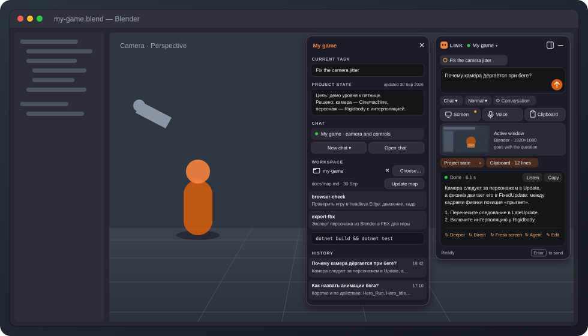
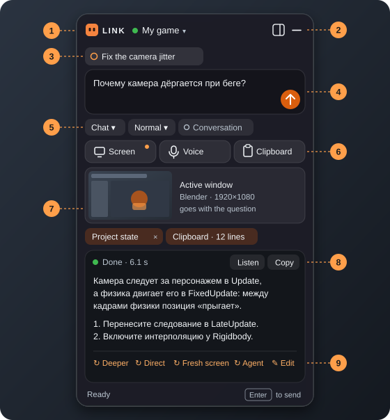
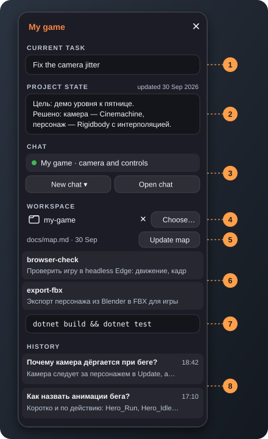
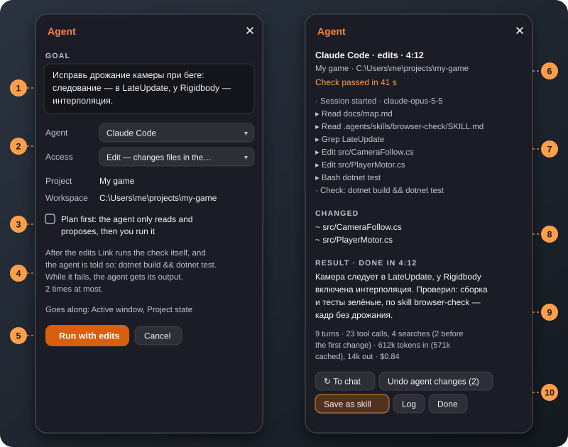
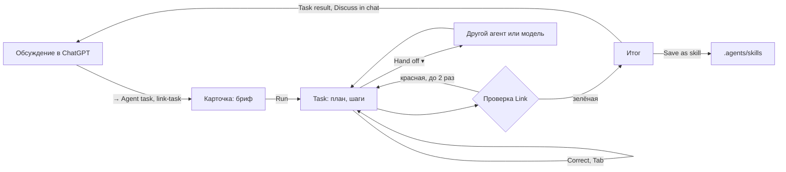

# Link

<p align="center">
  
</p>

Компактный Windows desktop companion на C#/.NET 10 и WPF. Вы работаете в Unreal, Blender, IDE или браузере, а Link
висит маленьким overlay поверх: собирает нужный контекст — текст, голос, скриншоты, clipboard, текущее приложение —
отправляет его в связанную беседу ChatGPT и показывает ответ, не заставляя переключаться в окно чата. Работу в вашей
папке — правки, проверки, карту проекта — делает агент на выбор: **Claude Code** или **Codex**.

**UI для пользователя — Link. Встроенная страница ChatGPT, CLI агентов — внутренняя реализация.**

## Как работать с Link

### 1. Спросить

<p align="center"></p>

1. **Проект и точка ChatGPT** — зелёная: на связи, красная: войдите в ChatGPT. Клик — выбрать или создать проект,
   связать его с беседой. Пока есть задача агента, рядом — **пилюля агента** (`Claude · 4:12`, `Claude needs you`,
   `Claude done`); клик открывает задачу.
2. **Панель** (Expand) и **Hide**. Спрятать и показать Link — `Ctrl+Alt+Space`.
3. **Заметка проекта** — чип с её первой строкой (над чем вы работаете); уходит с вопросом, `×` — без неё на один
   вопрос, клик — править.
4. **Вопрос.** Пишите или держите `Ctrl+Alt+V` и говорите — слова появляются в поле; `Enter` отправляет — подсказка
   внизу говорит куда: «sends to ChatGPT» или «opens the task card».
5. **Куда и как.** **To ChatGPT ▾** — ChatGPT или задача агенту проекта (раздел 3). **Fast · Normal · Deep** —
   насколько глубоко думать. **Conversation** — разговор без рук. **Only my text** — следующий вопрос уходит только
   с вашим текстом и вложениями, без чипов Link.
6. **Что видит модель** — строка **Sees** под полем: приложенный снимок (окно, монитор, область) или «свежий кадр
   окна при отправке», с миниатюрой; клик — меню снимков. Voice — голос, Clipboard — буфер обмена.
7. **Что уходит с вопросом** — чипы: приложение и заголовок его окна, состояние проекта, буфер; `×` убирает на этот
   запрос. Над ответом — **Saw: …**: что ушло на самом деле, с миниатюрой отправленного кадра.
8. **Ответ** приходит по мере печати, Markdown с кодом и таблицами; **Listen** читает вслух, **Copy** копирует.
9. **Под ответом два действия.** **Ask again ▾** — тот же вопрос из того же снимка: глубже, со свежим экраном, только
   ваш текст или с поправкой (Edit the question — поправить ослышку). **→ Agent task** — карточка задачи, где бриф —
   выделенная часть ответа, его блок `link-task` или весь ответ, плюс вопрос; ничего не запускается до Run.

### 2. Проект и панель

<p align="center"></p>

Две вкладки: **Project** и **Task** (задача агента, раздел 3).

1. **Заметка проекта** — первая строка: над чем вы работаете; дальше цель, решения, факты. Уходит с вопросами и
   задачами чипом, который можно убрать на один вопрос. Прежние «задача» и «состояние» стали ею сами.
2. Дата правки заметки.
3. **Беседа ChatGPT.** **New chat** начинает новую (в меню — с короткой выжимкой старой: длинные беседы ChatGPT
   отвечает медленно), **Open chat** показывает окно ChatGPT.
4. **Рабочая папка** — где работает агент; выбирается только явно.
5. **Карта проекта** — Write map / Update map: агент осматривает папку и пишет `docs/map.md` (что где лежит, как
   собрать и проверить); агенты читают её первой, а не ищут по папкам.
6. **Skills папки** — повторяемая работа, записанная один раз (раздел 3, Save as skill). Клик показывает `SKILL.md`.
7. **Проверка после правок** — ваша команда: сборка, линтер, тесты. Link сам запускает её после задачи с правками.
8. **История** — одна лента по времени: ответы ChatGPT и задачи агента (10 ответов и 20 задач, и после перезапуска
   Link). Клик по ответу показывает его в карточке, по задаче — открывает её во вкладке Task; ответ в ней
   продолжает её последнюю сессию.

### 3. Агент: одна задача с историей

<p align="center"></p>

Задачу открывает `Ctrl+Enter` в поле, **To ▾ → Agent task**, **→ Agent task** под ответом ChatGPT или **Give to agent**
на его блоке `link-task`. Сначала — карточка, потом вкладка **Task**: одна задача от брифа до Finish, сколько бы
прогонов, поправок и передач в ней ни было.

1. **Бриф** — то, что агент получит слово в слово (первая строка — название задачи); правится перед запуском.
   Ниже — что уходит вместе с ним (снимки, заметка, буфер).
2. **Агент, уровень, доступ.** Уровни **Light · Standard · Deep** — модель и effort из Settings → Agents (у Claude по
   умолчанию Sonnet 5.5 medium, ваша модель, Opus 5.5 extra high). Под агентом — его окна лимитов, если известны.
   Доступ: **Edit** — правит файлы, команды — с вашего разрешения; **Auto** — правит и запускает команды без вопросов,
   рискованное останавливает проверка самого агента.
3. **Сначала план** — агент только читает и предлагает (на Deep), запускаете вы: план выполняется в той же сессии на
   уровне карточки.
4. **Проверка после правок** (если задана у папки).
5. **Run** — без него ничего не запускается.
6. **Вкладка Task:** название, агент · уровень · модель · доступ · время, текущий шаг; **■ Stop** и **Console** (что
   Link отдал CLI и каждая строка его вывода, вживую).
7. **План агента** — его собственный список (TodoWrite у Claude, todo list у Codex): сделано, сейчас, осталось.
8. **Итог прогона** и его цифры (ходы, вызовы, поиски, токены); **Changed** — файлы всей задачи; **Steps** — шаги,
   открыты, пока агент работает. Петля помечается «Looks like a loop»: **Start over with a note** или **Escalate to
   Deep** (та же сессия на сильной модели).
9. **History** задачи — бриф, ваши слова, каждый прогон, проверки, передачи, смены модели, лимиты; **What Link gave**
   — бриф и каждая передача слово в слово; **Usage** — токены задачи по агентам и окна подписки (5 ч и неделя,
   время сброса) из данных самих CLI; $ по ценам API — только в подсказке.
10. **Поле для агента** говорит, куда уйдут слова: пока он работает, `Enter` — **Correct** (агент останавливает шаг и
    продолжает с вашими словами), `Tab` — **после этого прогона**; после — `Enter` — **Reply** в той же сессии.
11. **Hand off ▾** — другой агент в новой сессии (сначала карточка с брифом из истории задачи: ваши слова, план,
    файлы с `+/-`, последняя проверка, чем кончил первый — его можно поправить); другой уровень того же агента в той
    же сессии; **Back to …** — первый агент в своей сессии, ему расскажут, что сделал второй. **Start over** — новая
    сессия с заметкой. **Finish** — задача закрыта и лежит в истории. **More ▾** — **Discuss in chat** (итог с diff
    в контекст следующего вопроса ChatGPT), **Undo agent changes** / **Restore the copy**, **Save as skill**, Console.
12. **Лимит.** У 90 % окна Link тихо предлагает остановиться и передать задачу; кончился лимит — **Hand off to …**
    или **Continue at 15:45** (та же сессия продолжится сама после сброса, пока Link запущен). Сам Link ничего не
    передаёт.

После каждого прогона итог задачи сам ложится чипом **Task result** в следующий вопрос ChatGPT — `×` убирает.



### 4. Что Link даёт агенту

- **Правила** (`harness\agent-rules.md` рядом с `Link.exe`) — в начале каждой новой сессии, в любой папке:
  запуск без диалога, режим чтения, карта, skills, особенности Windows. `AGENTS.md` в папку класть не нужно.
- **Карта** `docs/map.md` и **skills** `.agents/skills/<имя>/SKILL.md` — один источник для обоих агентов: Codex
  находит skills сам, Claude Code получает их список с правилами.
- **Проверка — дело Link:** агенту сказано, что её запустит Link; красная возвращается агенту с концом вывода.
- **MCP-серверы проекта** (например, редактор Unreal) — один источник для обоих агентов, `.mcp.json` в рабочей
  папке: Claude Code читает его сам, Codex получает его серверы от Link. В Activity вызов MCP показывает сервер,
  инструмент и действие: `ue-mcp: tools call level place_actor`.
- **Лишнее не едет в каждый запрос:** Codex из Link работает без плагинов, приложений и управления компьютером своего
  десктопного приложения (ваши MCP-серверы, например Blender, остаются); git в песочнице Codex видит репозиторий
  рабочей папки своим.
- **Без субагентов** у обоих агентов: их шаги и токены не видны в Activity и в цифрах задачи.
- **Цифры** каждой задачи — в Activity и строкой `[Agent]` в `link.log`: по ним видно, что экономит.

## Установка и первый запуск

Нужны Windows 11 и .NET 10 SDK:

```powershell
dotnet build Link.sln --configuration Release
src\Link.Desktop\bin\Release\net10.0-windows\Link.exe
```

1. **ChatGPT.** Откройте панель (Expand в заголовке) и нажмите **Open chat**, войдите в свой аккаунт — один раз:
   вход хранится в профиле `%LocalAppData%\Link\WebView2`. Откройте нужную беседу, закройте окно, в панели нажмите
   строку беседы и **Link**. Или сразу **New chat** — первое сообщение из Link создаст беседу и свяжет её с проектом.
2. **Агенты.** Один раз `claude auth login` или `codex login`. Settings → Agents показывает, найден ли агент, вошли
   ли вы и его версию; там же — агент по умолчанию, доступ, с которого начинается карточка, свой путь к exe, модель
   (у Claude — Opus 5.5, Fable 5.1, Sonnet 5.5, Haiku 4.5; у Codex — модели вашего аккаунта из его списка; Default —
   настройка самого агента) и effort: Low, Medium, High, Extra high, Max — самый высокий. Ultra у Codex и ultracode у
   Claude работают через субагентов, а Link запускает агентов без них, поэтому их в списке нет.
3. **Инструкции для ChatGPT** — вставьте [docs/harness/chat-instructions.md](docs/harness/chat-instructions.md) в
   инструкции проекта ChatGPT, с которым связан Link; общие советы — [docs/harness/prompting.md](docs/harness/prompting.md).

`Alt+F4` прячет Link в tray, завершить его — `Exit` в меню tray. Перед пересборкой в `bin\Release` завершите Link:
запущенный `Link.exe` блокирует файл, а второй запуск только покажет «Link is already running». Номер сборки — внизу
Settings.

### Hotkeys по умолчанию

| Действие | Hotkey |
|---|---|
| Показать/скрыть | `Ctrl+Alt+Space` |
| Push-to-talk | `Ctrl+Alt+V` |
| Отправить запрос | `Ctrl+Alt+Enter` |
| Весь desktop | `Ctrl+Alt+D` |
| Активное окно | `Ctrl+Alt+W` |
| Выбор области | `Ctrl+Alt+Shift+R` |
| Conversation вкл./выкл. | `Ctrl+Alt+Shift+Space` |
| Спросить про экран (держать) | `Ctrl+Alt+Shift+V` |
| Задача агенту (в поле вопроса) | `Ctrl+Enter` |

Совет: клавиши `F13`–`F24` работают как hotkey без модификаторов — удобно повесить push-to-talk на кнопку макропада
или педаль (назначьте им F13–F24 в их программе, затем запишите клавишу в Settings).

## Возможности подробно

**Overlay**
- frosted-glass always-on-top: перетаскивание, ширина 320–1200 px, высота по содержимому; нижним краем задаётся
  предел роста (двойной клик по нему возвращает компактный режим); click-through, прозрачность;
- **Hide** — кнопка `—` в заголовке, двойной клик по заголовку или `Esc`, когда Link ничего не делает: Link прячется
  целиком, начатый ответ дописывается. Вернуть — hotkey показа (`Ctrl+Alt+Space`) или tray;
- **Expand** — кнопка панели в заголовке: рядом с карточкой открывается панель проекта. Она встаёт на ту сторону, где
  на мониторе больше места, ходит за карточкой и прячется вместе с ней; внешний край задаёт ширину;
- tray, один экземпляр, глобальные hotkeys (все меняются в Settings); позиция и размер сохраняются на нескольких
  мониторах;
- `Enter` отправляет, `Shift+Enter` — новая строка; во время ответа кнопка отправки и `Esc` останавливают запрос и
  генерацию в ChatGPT;
- иконка в tray показывает, что происходит: голубая точка — идёт запрос, красная — Link ждёт вас (вход в ChatGPT,
  решение агента или запрос не удался, пока Link был скрыт), зелёная — ответ пришёл, пока Link был скрыт (гаснет,
  когда Link покажется); подсказка иконки — строка статуса. Если Link скрыт или неактивен, о готовом ответе ещё и
  сообщает уведомление Windows; клик открывает нужный проект;
- короткие звуки (до 150 мс): слушаю, отправлено, нужно ваше решение, готово, ошибка. Пока Link говорит, звучит
  только «нужно решение»; выключаются в Settings → Behavior.

**Agent**
- доступ: **Edit** (Claude `acceptEdits`, Codex `workspace-write`) или **Auto** (по умолчанию; Claude `auto`, Codex
  `workspace-write` с автоматической проверкой запросов из песочницы). `bypassPermissions` и `danger-full-access` не
  используются никогда. Только чтение (Claude `dontAsk` с запретом инструментов записи, Codex `read-only`) — у
  Plan first и у ответов, которые Link пишет сам (карта, skill); в сессии, начатой так, Link предлагает
  **Retry with edits**;
- уровни Light · Standard · Deep — модель и effort каждого в Settings → Agents; без субагентов (Claude —
  `--disallowedTools Agent`, Codex — `features.multi_agent` выключен); смена уровня в той же сессии стоит один промах
  кэша; карта, skill и заметка Start over идут на Light (настройка);
- **задача** — запись в `Projects\<id>\agent-tasks.json` (20 последних): бриф, прогоны (агент, модель, сессия, итог,
  токены — у Codex разница с прошлым итогом сессии), лента, план агента, файлы, последняя проверка, шаги; сессии
  прежнего Link читаются задачами из одного прогона;
- **■ Stop** виден всё время и останавливает агента со всеми его процессами; после выхода из Link их тоже нет;
- **лимиты** — Claude Code сообщает их событием `rate_limit_event`, Codex пишет `rate_limits` в журнал своей сессии
  (Link читает только эти строки); последнее известное — `agent-limits.json` с временем;
- **Console** — отдельное окно: для каждого прогона задачи команда CLI, папка, переменные Link и весь текст на stdin,
  затем каждая строка stdout и stderr (`!`) по мере прихода; только текущая задача, до ~2 МБ, строка длиннее 4000
  символов обрезается;
- **передача** — Hand off ▾ → другой агент: новая сессия в той же папке с тем же доступом и проверкой; бриф из записи
  задачи (до ~1,5k токенов: старые шаги уходят первыми, задача и ваши слова — никогда) сначала на карточке. Откат и
  Start over покрывают обоих; **Back to …** продолжает сессию первого агента со сводкой сделанного вторым;
- отказ Claude в инструменте → «Allow and retry» (продолжение той же сессии; «Always allow for this project»
  запоминает правило); агенту в режиме чтения понадобились правки или команды → «Retry with edits»; «Сначала план»
  → «Run the plan»;
- **откат**: в git — «Undo agent changes» только для файлов, которые до задачи были чистыми (ваши правки не
  трогаются); без git — копия рабочей папки перед изменениями (до 2 ГБ, без `bin`, `obj`, `node_modules` и т. п.) и
  «Restore the copy». Всё — после подтверждения;
- **харнесс всегда** — каждая новая сессия агента начинается с правил агента (`harness\agent-rules.md` рядом с
  `Link.exe`, правится без пересборки), что бы ни лежало в рабочей папке. Claude Code там же получает список skills
  рабочей папки, Codex находит их сам. Codex из Link запускается без добавок своего десктопного приложения
  (`plugins`, `apps`, `tool_suggest`, `computer_use`, `browser_use`), а его песочнице git передан `safe.directory`
  репозитория рабочей папки;
- **цифры задачи** — строкой под итогом: ходы, вызовы инструментов, из них поиски (и сколько до первой правки),
  ошибки инструментов, токены (сколько из кэша) и стоимость по ценам API (Codex её не сообщает); те же числа — в
  строке `[Agent]` link.log. Codex, продолжая сессию, считает токены всей сессии — такие числа помечены
  «for the session»;
- **карта проекта** — агент в режиме чтения осматривает папку и отвечает картой, Link пишет её в `docs/map.md` (до
  ~80 строк). Это единственное изменение, оно в Activity и откатывается как обычно. Задание агенту —
  `harness\map-task.md` рядом с `Link.exe`;
- **Save as skill** — после удачной задачи та же сессия агента в режиме чтения описывает сделанное как skill (когда
  применять, шаги, команды, скрипты проекта — ссылками, подводные камни, до ~60 строк), Link пишет его в
  `.agents/skills/<имя>/SKILL.md`. Имя — строчная латиница, цифры, дефис; skill с тем же именем заменяется только
  после «да». Это единственное изменение, оно в Activity и откатывается как обычно; задание агенту —
  `harness\skill-task.md` рядом с `Link.exe`;
- **проверка после изменений** — команда запускается как есть в рабочей папке (через cmd.exe, до 10 минут, Stop
  работает); красная — агент продолжает сессию с концом её вывода, не больше двух раз, и задача кончается
  «Check failed», а не «Done». Вывод проверки в link.log не пишется;
- **петли** — Activity помечает «Looks like a loop: …»: тот же вызов 3 раза без правок между ними, та же ошибка
  3 раза подряд, 12 поисков подряд без правки (только с изменениями). Агент не останавливается — решаете вы;
- **Start over with a note** — рядом с меткой петли и после провала: агент (если работает — после Stop) пишет в пяти
  строках, что пробовал и почему не вышло, и новая сессия берёт исходную задачу с этой заметкой, тем же доступом и
  папкой, вместо продолжения замусоренной истории;
- голосом агент говорит только старт, нужное решение и итог в 1–2 фразы; скрытый Link сообщает о нём иконкой tray,
  звуком и уведомлением.

**Контекст**
- скриншоты: текущий монитор, весь рабочий стол, каждый монитор, рабочее окно, выбранная область (одна за раз);
  «A fresh frame of the window on every send» в меню Sees делает свежий снимок рабочего окна для каждого вопроса;
- захват через Windows.Graphics.Capture: игры, видео и страницы, которые рисует видеокарта, выходят как на экране, а
  окно снимается целиком, даже под оверлеем, — Link для этого не прячется и не забирает фокус. Запасные пути —
  PrintWindow и снимок экрана; чёрный кадр (эксклюзивный fullscreen, защищённое видео) не прикладывается молча —
  статус говорит почему. Каждый захват — строка `[Capture]` в `link.log` (способ, размер, время, без заголовков);
- снятое окно на полсекунды обводится оранжевой рамкой (Settings → Behavior, не над fullscreen);
- над игрой во весь экран Link появляется без фокуса; поверх эксклюзивного fullscreen он не показывается вовсе — его
  бы выбросило из полного экрана: ответ звучит голосом и приходит уведомлением;
- **Спросить про экран** — держите `Ctrl+Alt+Shift+V`, спросите, отпустите: вопрос сразу уходит в Chat со свежим
  кадром рабочего окна, ответ читается вслух (голосовые ответы включены по умолчанию);
- clipboard и текущее приложение в видимом context stack;
- проекты (по умолчанию General) и их панель: текущая задача, состояние проекта (дата — когда правили), связанная
  беседа, рабочая папка и 10 последних вопросов и ответов. Состояние уходит в запрос чипом «Project state»: его можно
  убрать для одного запроса, после ответа он возвращается;
- рабочее приложение фиксируется в момент вызова Link: просмотр ChatGPT и скрытие Link при захвате экрана его не
  подменяют.

**Голос**
- push-to-talk: слова появляются в поле, пока вы говорите (локальный распознаватель, RU или EN), после отпускания
  Whisper заменяет черновик финальным текстом — large-v3-turbo на видеокарте, Base на CPU; запись без речи в Whisper
  не идёт;
- выбор и тест микрофона — Settings → Microphone;
- голосовой ответ на продиктованный вопрос: Link читает ответ по мере его прихода — первую фразу, пока ChatGPT
  пишет дальше; код и таблицы не читает («Код — на экране.»), длинный ответ обрывает примерно через минуту речи. При
  долгом ожидании говорит короткую фразу («Секунду.»). Push-to-talk во время речи перебивает; Esc и Stop сначала
  заглушают, повторно — останавливают запрос. Кнопка **Listen** на ответе читает его заново, во время речи она же —
  Stop; по желанию озвучиваются и ответы на набранные вопросы (Settings → Voice replies → «…and when I type»);
- голос ответа (Settings → Voice replies → Voice engine): **Gemini** 3.8 Flash-Lite TTS — естественный, нужен свой
  бесплатный ключ из aistudio.google.com/apikey (хранится зашифрованным для вашей учётной записи Windows); в Gemini
  уходят только слова, которые Link произносит, а на бесплатном тарифе Google может использовать их для улучшения
  своих продуктов. Звук Gemini бывает медленнее, чем играется, поэтому Link начинает говорить, накопив 2 с звука.
  **Локальный голос** Supertonic 3 — офлайн, скачивается кнопкой (145 МБ); без ключа Gemini и без скачанной модели
  Link не говорит, ответ остаётся на экране. В режиме Auto, если Gemini недоступен (лимит, сеть, ключ), говорит
  локальный голос, а статус коротко сообщает почему;
- **Conversation** — разговор без рук: метка под полем, Settings → Voice или `Ctrl+Alt+Shift+Space`. Пока Link
  свободен, он слушает сам; пауза ~0,65 с после фразы — короткий сигнал «услышал», Whisper распознаёт только фразу, и
  она уходит выбранным маршрутом. Ответ звучит всегда (даже с выключенным Voice replies), в Chat — с просьбой начать
  коротко и разговорно; потом Link снова слушает. Пока идёт запрос и пока Link говорит, микрофон закрыт;
  push-to-talk перебивает ответ, работает и пока ChatGPT думает (новые слова уйдут после ответа) и может сам закончить
  фразу; Send заканчивает её сразу. Нажатая в поле ввода клавиша ставит прослушивание на паузу — можно печатать; Link
  слушает снова после отправки, очистки поля или ухода из него. Нераспознанную фразу просто повторите. Включённый режим
  остаётся включённым и после перезапуска Link; выключенный ничего не слушает.

**ChatGPT**
- ChatGPT живёт во встроенном окне Link (WebView2): браузер держать открытым не нужно, ответ печатается с полной
  скоростью — сотни символов в секунду, а не 3–5, как в фоновой вкладке. Закрытое окно Link убирает за край экрана, и
  оно продолжает работать;
- уровень **Fast / Normal / Deep** переключает и режим ChatGPT: Fast ставит самый лёгкий, Normal возвращает ваш;
- запрос не зависает: статус в шапке ответа (Sending, Waiting for response, Receiving, Reconnecting, Cancelled,
  Error) и понятные ошибки; после перезагрузки страницы ответ подхватывается без повторной отправки;
- **Check chat** забирает ответ прямо из чата, если он не дошёл; Link и сам проверяет чат после 20 с тишины;
- снимки трёх последних вопросов каждого проекта Link держит вместе с их файлами — для ↻ и ✎ Edit; ссылки из ответа
  открываются в браузере по умолчанию;
- когда длинный чат начинает отвечать медленно, статус подсказывает начать новый.

## Проверки

Проверки логики без микрофона и настоящего ChatGPT — консольный раннер, код выхода равен числу ошибок. Он же
прогоняет companion на мок-страницах ChatGPT в headless Edge или Chrome (без них эти проверки пропускаются).
CI запускает раннер после сборки.

```powershell
dotnet run --project tests/Link.Desktop.Tests
```

## Локальные данные

`%LocalAppData%\Link`:

- `settings.json` — UI, панель, hotkeys, голос и звуки, агенты;
- `projects.json` — проекты: заметка, рабочая папка, проверка, связанная беседа и её последний ответ;
  `Projects\<id>\` — папка проекта, в ней `history.json` с 10 последними вопросами и ответами и `agent-tasks.json` с
  20 последними задачами агента;
- `agent-limits.json` — окна подписки агентов, как их последний раз сообщили CLI;
- `Screenshots\` — ограниченная история PNG; снимки рабочего окна для Auto active window живут, пока Link держит их
  вопрос для перенаправления, и удаляются при выходе; `Recordings\` — последние WAV;
- `Models\` — модели распознавания речи и локального голоса;
- `Backups\` — копии рабочих папок без git перед изменениями агента, 5 последних;
- `WebView2\` — профиль встроенного ChatGPT: вход и cookies; `companion-state.json` — режимы ChatGPT, которые
  выставил Link;
- `last-request.json` — последний запрос: текст, пути вложений, заголовок окна. Пишется только с диагностикой
  (Settings → Behavior → Diagnostics, по умолчанию выключена); без неё Link этот файл удаляет;
- `link.log` — неожиданные ошибки и диагностика (UTF-8, до 1 МБ): строка `[Chat]` на каждый запрос (маршрут и
  уровень, подготовка в Link, приём страницей, первый текст, скорость ответа), `[TTS]` — путь каждой фразы до звука,
  `[Voice]` — сколько микрофон слушал и как быстро фраза стала текстом, `[Agent]` — каждый прогон агента (агент,
  доступ, итог, session id, время, файлы, отказы, цифры задачи; без текста задачи).

## Архитектура

```text
src/Link.Desktop/
├── Models/        settings, projects, context, PromptRequest, задачи и события агента
├── Services/      storage, запрос, chat integration, голосовая сессия, STT и TTS, агенты и харнесс
├── Windows/       Win32: hotkeys, стили окон, захват (Windows.Graphics.Capture, GDI), fullscreen, waveIn, tray
├── MainWindow*    overlay; части по темам: Chat, Capture, Voice, Sizing, Panel, Agent
├── SidePanelWindow*, ProjectPanel*, AgentPanel*  панель рядом с карточкой и её содержимое
├── ChatPageWindow встроенная страница ChatGPT (WebView2) за краем экрана
├── SettingsWindow*, RegionSelectionWindow*, ...
companion/                  content.js работает с DOM ChatGPT во встроенной странице
docs/harness/               правила и задания агента (копируются к Link.exe), инструкции для ChatGPT
.agents/skills/             skills агентов, которые работают над самим Link: пересборка, рисунки, разбор токенов
tests/Link.Desktop.Tests/   проверки логики без тестового фреймворка
tests/companion/            проверки companion на мок-страницах ChatGPT
```

- Отправка: окно собирает `InputSnapshot` (текст, context stack, рабочее окно, его снимок), `AttemptCoordinator`
  строит из него `PromptRequest` по маршруту и уровню, отправляет, пишет строку `[Chat]` и хранит последний ответ
  проекта; перенаправление — новая попытка из того же снимка.
- `PromptRequest` и контекст принадлежат Link; `IChatIntegration` отделяет их от транспорта. Для ChatGPT это
  `EmbeddedChatIntegration`: страница ChatGPT в собственном окне Link, где `content.js` работает поверх
  `embedded-host.js` и говорит с Link через канал WebView2. Жизнь запроса (повторная выдача, тишина, Stop,
  Check chat) ведёт `ChatRequestBroker`. Подробно — [`companion/README.md`](companion/README.md).
- Агент: `AgentCoordinator` строит задачу из снимка и карточки, запускает провайдера (`ClaudeCodeProvider`,
  `CodexProvider` поверх общего `CliAgentProvider` и `AgentProcess`), проверяет результат командой проекта и находит
  изменения (`AgentChanges`: git или копия). Харнесс — `AgentRules`, `ProjectMap`, `ProjectSkills`.
- Окно страницы никогда не прячется и не сворачивается — иначе движок притормозит страницу, — а ждёт за краем экрана
  с флагами Chromium против фонового троттлинга.
- `VoiceSession` — единственный владелец голосового состояния (Idle → Listening → Finalizing → Sending → Waiting →
  Speaking); UI только отображает фазу и черновик. Один захват waveIn кормит и WAV для Whisper, и live-распознаватель.
  В Conversation окно открывает микрофон hands-free, когда Link свободен; конец фразы слышит Silero VAD.

## Ограничения

- **ChatGPT.** В очень длинной беседе ChatGPT сам отвечает медленно: первое слово через 15–25 с, дальше несколько
  символов в секунду — и в Link, и в самом ChatGPT. Новый чат отвечает за 2 с и печатает ~250 символов в секунду:
  когда беседа разрослась, начните новую (New chat, при нужде — с выжимкой). Встроенная страница — это процессы Edge
  WebView2: сразу после ответа 650–750 МБ памяти. Через полминуты без запросов она «отдыхает»: не рисуется, CPU почти
  ноль, память — около 450 МБ; к следующему запросу просыпается сразу. Раз в 6 часов простоя Link загружает её заново.
- **DOM ChatGPT.** Конец ответа companion узнаёт по нескольким признакам, а при смене разметки пишет в `link.log`, что
  видела страница. Переключение режима эвристическое: если не вышло, статус пишет «ChatGPT mode not switched (…)», а
  подсказка всё равно уходит в запрос.
- **Голос.** При первом использовании скачиваются модели (Whisper Base 148 МБ; turbo 574 МБ, если есть видеокарта с
  Vulkan; live-модели 30–45 МБ; всё проверяется по SHA-256). Нужен Microsoft Visual C++ Redistributable 2022 x64.
  Бесплатный тариф Gemini ограничен по запросам: при исчерпании Link минуту–час говорит локальным голосом.
  Локальный голос, пока говорит, держит ~300 МБ памяти и выгружается через 3 минуты тишины. В Conversation
  микрофон открыт, пока Link свободен: слушание — 4–5 % одного ядра; разговор или видео рядом Link может принять за
  вопрос — тогда выключите режим. Эхоподавления нет: перебить ответ голосом нельзя, только push-to-talk.
- **Агенты.** Claude Code и Codex — только для действий в рабочей папке, чат — только ChatGPT. Агента Link не ставит
  и не входит в него; одна задача агента за раз.
- **Экран.** Игра в эксклюзивном fullscreen и защищённое (DRM/UAC) видео захватываются чёрными — Link такой кадр не
  прикладывает: переключите игру в borderless или спрашивайте голосом. Снимок монитора и области по-прежнему на миг
  прячет Link (окна WPF с прозрачностью нельзя исключить из захвата); окно — нет.
